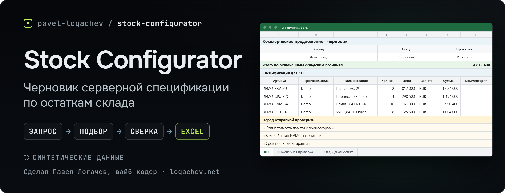

<picture><source media="(max-width: 767px)" srcset="docs/assets/stock-configurator-banner-mobile.png"></picture>

# Stock Configurator

[](https://github.com/pavel-logachev/stock-configurator/actions/workflows/ci.yml) [](<LICENSE>)

**Превращает запрос клиента в черновик серверной спецификации по остаткам дистрибьютора — с Excel для проверки инженером.**

[Статья](<https://logachev.net/journal/podbor-oborudovaniya-po-skladu-ii/>) · [Архитектура](<docs/ARCHITECTURE.md>) · [Быстрый старт](<#быстрый-старт-в-docker>) · [API](<#api>)

## Коротко

| | |
| --- | --- |
| **Для кого** | Пресейл и продажи дистрибьюторов и интеграторов |
| **На входе** | Запрос обычным текстом и данные склада через API |
| **На выходе** | Excel: черновик КП, инженерные проверки и складская диагностика |
| **Интерфейсы** | Telegram-бот и API на FastAPI |
| **Кто отвечает за решение** | Инженер проверяет состав, совместимость и готовность к КП |

## Почему не просто чат-бот

В сценарии Telegram-бота (`simple-stock-quote`) модель выбирает из полученных складских позиций. Код сопоставляет ее выбор с данными дистрибьютора: берет оттуда артикулы, цены и остатки, пересчитывает суммы. Неизвестная позиция блокирует выдачу черновика.

Количество сверх точного остатка сокращается с пометкой; остаток вида «>1» требует подтверждения доступности. Если подходящего оборудования нет, система так и отвечает — `no_recommendation`.

**Сверка со складом не доказывает совместимость компонентов.** Решение о готовности спецификации к коммерческому предложению остается за инженером. У маршрута `full-category` сверка устроена иначе — см. [API](<#api>).

## Что видит инженер

Для `simple-stock-quote` и `full-category` Excel содержит три листа:

- **«КП»** — «Коммерческое предложение - черновик». В спецификации: артикул, производитель, наименование, кол-во, цена, валюта, сумма и комментарий. Ниже — список «Перед отправкой проверить».
- **«Инженерная проверка»** — покрытие требований, допущения, отклонения и сведения о совместимости из ответа модели.
- **«Склад и диагностика»** — выбранные складские строки с идентификаторами, корректировки сверки, ошибки и предупреждения.

Результат также сохраняется в Markdown. Черновик получает оператор — клиенту он автоматически не отправляется.


*От запроса клиента — к складским позициям и черновику для проверки инженером.*

## Как это устроено

**Стек:** Python, FastAPI, PostgreSQL, Telegram, Excel. Модель подключается через OpenAI-совместимый API.

В сценарии `simple-stock-quote`: запрос → требования и категории → матрица остатков → черновик модели → сверка со складом → отчеты → проверка инженером.

- [`app/distributors`](<app/distributors>) — коннекторы OCS и Treolan; [`app/matching`](<app/matching>) — подготовка данных и сверка.
- [`app/llm`](<app/llm>) — разбор запроса и сборка конфигурации; [`app/reports`](<app/reports>) — Excel и Markdown.
- [`app/api`](<app/api>) и [`app/telegram_bot`](<app/telegram_bot>) — интерфейсы; [`app/evaluation`](<app/evaluation>) — офлайн-оценка.

## Что опубликовано, а что нет

**Опубликовано:** исходный код рабочего проекта, миграции, тесты, конфигурация Docker и синтетические данные.

**Не опубликовано:** закрытая история Git, учетные данные, запросы клиентов, реальные цены и снимки остатков, рабочие результаты моделей и принятые эталонные случаи.

Это не облачный сервис и не доступ к складам: для реального подбора нужны ваши интеграции. Подробнее — [граница публичного релиза](<docs/PUBLIC_RELEASE_BOUNDARY.md>).

## Быстрый старт в Docker

Нужен Docker Engine с Compose v2. Из корня репозитория:

```bash
cp .env.example .env
docker compose up --build -d stock-api
docker compose exec stock-api alembic upgrade head
curl http://127.0.0.1:8010/health
```

Ожидаемый ответ:

```json
{
  "status": "ok",
  "service": "stock-configurator",
  "environment": "dev"
}
```

Документация API — <http://127.0.0.1:8010/docs>. Сервис доступен только с локального компьютера.

По умолчанию модель и веб-подтверждения выключены, учетных данных дистрибьюторов нет. Этот запуск поднимает сервис, но не настраивает реальный подбор. Интеграции подключаются через локальный `.env` на основе [`.env.example`](<.env.example>).

Telegram-бот запускается отдельно, после настройки доступа:

```bash
docker compose --profile telegram up --build -d
```

## Локальная разработка

Нужен Python 3.12 или новее.

```bash
python -m venv .venv
source .venv/Scripts/activate  # Git Bash в Windows
python -m pip install --upgrade pip
python -m pip install -e ".[dev]"
ruff check .
pytest -q
```

Тесты используют заглушки и синтетические данные; реальные учетные записи не нужны. [CI](<.github/workflows/ci.yml>) запускает линтер и тесты, проверяет конфигурацию Compose, применяет и проверяет миграции в PostgreSQL, собирает Docker-образ и проверяет зависимости. **Контейнеры через Compose в CI не запускаются.**

Подробности — [локальная разработка](<docs/LOCAL_DEVELOPMENT.md>).

## API

- `GET /health`
- `POST /api/v1/match`
- `POST /api/v1/match/v3/full-category`
- `POST /api/v1/match/v3/simple-stock-quote`
- `GET /api/v1/match` и `GET /api/v1/match/{id}`
- отчеты Markdown и Excel для сохраненных запусков

Для подбора нужна заполненная база остатков, для вызова модели — явно настроенный OpenAI-совместимый адрес.

**Граница проверки:** `simple-stock-quote` сверяет выбор со складом. В `full-category` код проверяет только схему ответа модели; механическая сверка отключена. Конфигурация передается на проверку со статусом `valid_unchecked` и предупреждением `code_validation_bypassed`.

## Оценка, безопасность и данные

- **Оценка:** базовый и новый запуски сравниваются по данным, привязанным к хешам. Один публичный синтетический случай недостаточен для приемки и не доказывает качество модели. Нужен собственный авторизованный корпус — см. [офлайн-оценку](<evaluation/simple_stock/v1/README.md>).
- **Данные:** секреты — в переменных окружения; реальные запросы, остатки и результаты оценки — вне Git. Не добавляйте их в тесты и pull request.
- **Развертывание:** Compose предназначен для localhost. Аутентификация, TLS, резервное копирование и сетевые политики рабочей среды — ответственность развертывающей стороны. Об уязвимостях сообщайте приватно по [политике безопасности](<SECURITY.md>).

## Автор, участие и лицензия

**Павел Логачев** — автор проекта. [logachev.net](<https://logachev.net/>) · [pavel@logachev.net](<mailto:pavel@logachev.net>). Есть похожая задача с каталогом или складом — напишите.

**Товарные знаки.** OCS, Treolan, Telegram и названия продуктов принадлежат их владельцам. Проект независим и ими не одобрен. Для коннекторов нужны ваши учетные записи и соблюдение условий соответствующих сервисов.

**Участие.** Предлагайте небольшие изменения с тестами и синтетическими данными; сохраняйте сверку результата и проверку инженером. См. [как участвовать](<CONTRIBUTING.md>).

**Лицензия:** [AGPL-3.0-only](<LICENSE>). © 2026 Павел Логачев. Если измененная программа доступна по сети, пользователям нужно предложить ее соответствующий исходный код.
